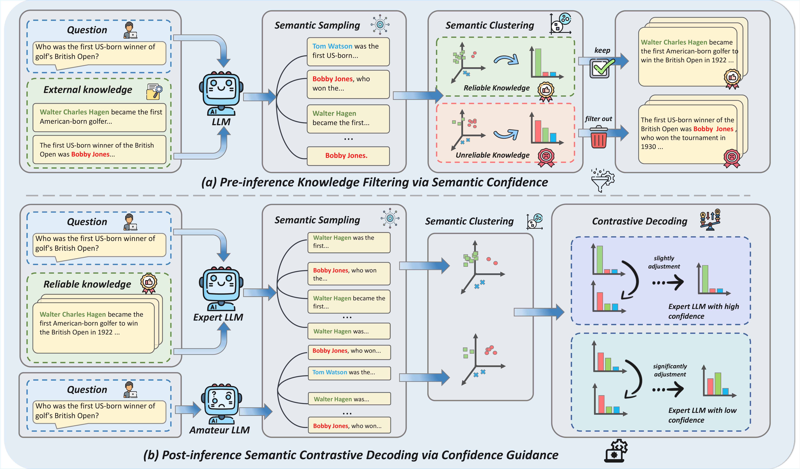

# DS-CMS²: Dual-Stage Confidence Measurement in Semantic Space

This repository currently contains a partial implementation of **DS-CMS²**, a training-free framework for mitigating knowledge conflicts in retrieval-augmented generation (RAG).

## Method Overview

> **[Mitigating Knowledge Conflicts of Retrieval-Augmented Generation through Dual-Stage Confidence Measurement in Semantic Space](./Mitigating_Knowledge_Conflicts_of_Retrieval-Augmented_Generation_through_Dual-Stage_Confidence_Measurement_in_Semantic_Space.pdf)**  
> Jia Zhang, Zhiheng Zhang, Zeao Ji, Tengfei Ma, and Daojian Zeng. COLM 2026.

## Overview

RAG can be harmed by two distinct forms of conflict:

- **Inter-context conflict:** retrieved documents disagree with one another or contain irrelevant/misleading evidence.
- **Context-memory conflict:** retrieved evidence disagrees with the language model's parametric knowledge.

DS-CMS² addresses both without additional training by measuring confidence in **semantic space** at two stages:

1. **Pre-inference knowledge filtering.** For each evidence document, the model samples multiple answers, clusters semantically equivalent answers, and computes semantic entropy. Documents whose entropy exceeds a threshold are filtered out; if none remain, the method falls back to closed-book generation.
2. **Post-inference semantic contrastive decoding (SCD).** The model generates answer distributions in professional (context-aware) and amateur (question-only) modes, jointly clusters their raw samples, and uses the expert semantic entropy as a dynamic contrast strength. This emphasizes answers supported by reliable context while avoiding fixed-strength overcorrection.

## Citation

~~~bibtex
@inproceedings{
zhang2026mitigating,
title={Mitigating Knowledge Conflicts of Retrieval-Augmented Generation through Dual-Stage Confidence Measurement in Semantic Space},
author={Jia Zhang and Zhiheng Zhang and Zeao ji and Tengfei Ma and Daojian Zeng},
booktitle={Third Conference on Language Modeling},
year={2026},
url={https://openreview.net/forum?id=5o9JbvsF1x}
}
~~~

